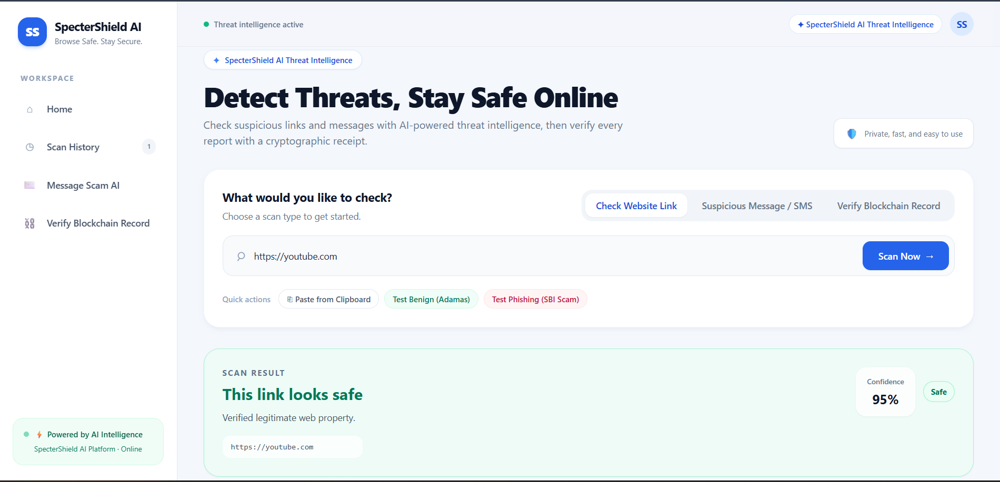
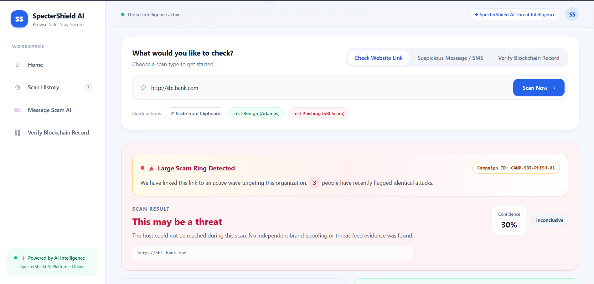
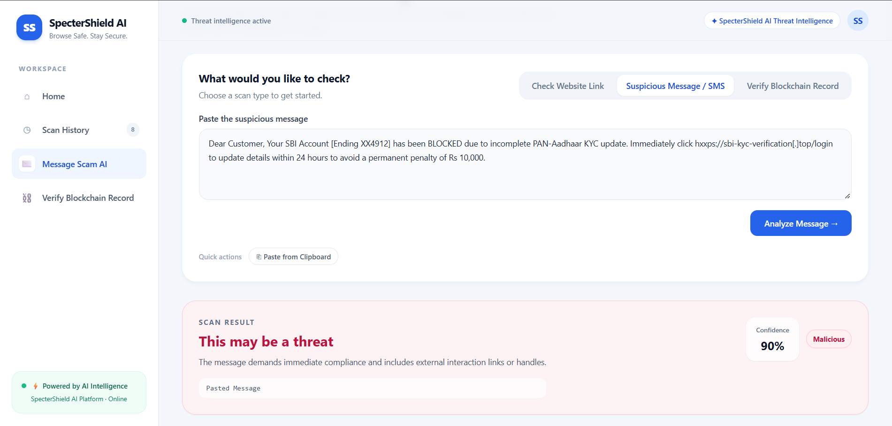
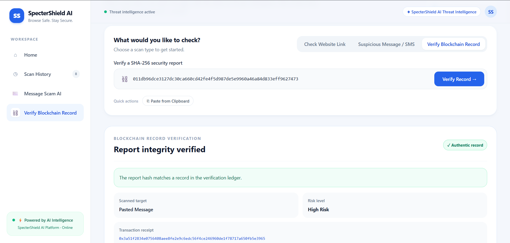

# SpecterShield AI

<<<<<<< HEAD
[](https://opensource.org/licenses/MIT)

AI-assisted threat intelligence monorepo for URL, TLS, scam, and HTTP header analysis.
=======
> Autonomous Threat Intelligence & Verifiable Security Ledger
>>>>>>> 1b4b703fcb099803b2aec33f3b12384d065c45ba

---

## 1. Project Name and Description

**SpecterShield AI** is an autonomous threat intelligence and verification platform that analyzes suspicious links, phishing domains, and scam messages via AI-driven triage and TLS heuristics, logging every forensic audit to a tamper-proof cryptographic ledger.

<<<<<<< HEAD
- Deploy the FastAPI service from `backend/`; its `Procfile` reads the platform-provided `PORT`.
- Set backend `ALLOWED_ORIGINS` to a comma-separated list of frontend origins. The default allows localhost development and `https://*.vercel.app`.
- Set the Vercel build environment variable `NEXT_PUBLIC_API_URL` to the backend origin (for example, `https://your-backend-service.onrender.com`). The frontend appends `/api/v1`.
- Copy `backend/.env.example` and `frontend/.env.example` for local configuration. Do not commit environment files containing credentials.

## License

This project is licensed under the MIT License. See the root [LICENSE](./LICENSE) file for details.
=======
---

## 2. Problem

Modern social engineering attacks—spanning brand impersonation, urgent SMS/WhatsApp phishing, and credential-harvesting lookalike domains—move faster than traditional threat blocklists can catalog:

* **Evasive Domain Infrastructure:** Attackers deploy short-lived lookalike domains with valid automated TLS certificates to bypass simple reputation filters.
* **Complex Deceptive Phrasing:** Malicious SMS and email campaigns use conversational urgency, OTP extortion patterns, and defanged URLs (`hxxps://`, `[.]`) that slip past standard static keyword checks.
* **Lack of Forensic Verifiability:** When threat analysts or security software flag a suspicious asset, reports often exist in volatile, centralized databases with zero cryptographic guarantee against tampering or retroactive modification.

---

## 3. Solution

SpecterShield AI delivers a unified defensive pipeline that ingests targets, runs deep multi-vector analysis, generates an evidence-backed risk verdict, and locks the incident record onto an immutable ledger:

* **Dual-Input Threat Scanner:** Analyzes suspect domains/URLs for typosquatting, dynamic redirect chains, domain entropy, and active URLhaus malware signatures.
* **TLS Certificate Auditing:** Connects directly via cryptographic sockets to verify certificate authority trust chains, expiration windows, Subject Alternative Names (SAN), and self-signed anomalies.
* **AI Message Deobfuscation:** Employs an LLM entity-extraction pipeline to defang suspicious text, isolate attack vectors, extract impersonated entities (e.g., banks, telecom), and evaluate manipulation tactics.
* **Cryptographic Verification Ledger:** Every investigation is hashed via SHA-256 and committed with a unique transaction receipt (`tx_hash`) and UTC timestamp into an immutable ledger, allowing anyone to verify report authenticity without revealing private threat telemetry.

---

## 4. Demo Links and Screenshots

* **Live Web Application:** [https://ai-threat-intelligence-tau.vercel.app](https://ai-threat-intelligence-tau.vercel.app)
* **Backend API Engine / Health Check:** [https://ai-threat-intelligence-backend-3jqq.onrender.com/health](https://ai-threat-intelligence-backend-3jqq.onrender.com/health)
* **GitHub Repository:** [https://github.com/Animesh-Maiti/ai-threat-intelligence](https://github.com/Animesh-Maiti/ai-threat-intelligence)

---

### 1. Benign Web Reputation & Domain Verification
Automated allowlist verification and TLS certificate integrity checks confirming legitimate web properties:



---

### 2. Phishing & Threat Detection Engine
Real-time URL threat triage identifying suspicious infrastructure, domain entropy, and brand impersonation attacks:



---

### 3. AI Message & SMS Scam Deobfuscation
Google Gemini AI analyzing coercive banking scam messages, defanging malicious vectors, and flagging deceptive intent:



---

### 4. Immutable Blockchain Ledger Verification
Cryptographic SHA-256 integrity lookup verifying tamper-proof incident provenance and ledger transaction receipts:


## 5. Tech Stack

### Frontend

* **Framework:** Next.js 14+ (App Router)
* **Language:** TypeScript
* **Styling:** Tailwind CSS
* **Icons:** Lucide React
* **Deployment:** Vercel Production Network

### Backend & Security Engine

* **Framework:** FastAPI (Python 3.11)
* **Server Execution:** Uvicorn ASGI (Multi-Worker Engine)
* **Data Validation:** Pydantic v2
* **Networking & TLS Forensics:** Python `ssl`, `socket`, `requests`, `urllib3`
* **Threat Feed Integration:** Abuse.ch URLhaus API integration
* **Deployment:** Render PaaS

### AI & Language Processing

* **Engine:** Google Gemini 1.5 Pro / Flash via Google GenAI SDK
* **Role:** Deobfuscation, social-engineering intent classification, urgency quantification, and entity extraction

### Cryptographic Ledger & Audit

* **Integrity Hashing:** SHA-256 cryptographic digests
* **Web3 Integration:** `web3.py` interface hooks for Ethereum-compatible networks
* **Ledger Store:** Persistent, normalized file-backed JSON ledger (`blockchain_ledger.json`) across concurrent worker processes

---

## 6. Architecture

```text
                          +------------------------------------------+
                          |        User / Security Analyst           |
                          +------------------------------------------+
                                               |
                                     HTTPS / WSS Requests
                                               v
                          +------------------------------------------+
                          |          Next.js Frontend (Vercel)       |
                          |   - URL Scanner Tab                      |
                          |   - SMS / Message Scam AI Tab            |
                          |   - Ledger Verification Tab              |
                          +------------------------------------------+
                                               |
                                        REST API Calls
                                               v
                          +------------------------------------------+
                          |        FastAPI Engine (Render)           |
                          +------------------------------------------+
                               /               |              \
                              /                |               \
                             v                 v                v
    +-----------------------------+  +--------------------+  +----------------------+
    |    Cybersecurity Module     |  |   Gemini AI Core   |  |   Threat Feeds       |
    |  - TLS Cert Validation      |  |  - NLP Deobfuscate |  |  - URLhaus Query     |
    |  - DNS & Entropy Scoring    |  |  - Scam Intent     |  |  - Redirect Tracer   |
    |  - Typosquatting Match      |  |  - Entity Extract  |  |  - Safe Allowlist    |
    +-----------------------------+  +--------------------+  +----------------------+
                             \                 |                /
                              \                |               /
                               v               v              v
                          +------------------------------------------+
                          |       Risk Aggregation & Scoring         |
                          |  - Weight calculations & triage verdict  |
                          |  - Canonical SHA-256 report generation   |
                          +------------------------------------------+
                                               |
                                    Audit Record Commitment
                                               v
                          +------------------------------------------+
                          |      Web3 Integrity Ledger Module        |
                          |  - Generates cryptographic `tx_hash`     |
                          |  - Commits receipt to immutable ledger   |
                          |  - Enables public tamper-proof lookup    |
                          +------------------------------------------+
```

---

## 7. Setup and Run Steps

### Prerequisites

* **Node.js:** v18.17.0+ installed
* **Python:** v3.10+ installed
* **Git:** Installed on system path
* **Google Gemini API Key:** Required for message triage analysis

---

### Local Backend Setup

1. **Clone the repository:**

   ```bash
   git clone https://github.com/Animesh-Maiti/ai-threat-intelligence.git
   cd ai-threat-intelligence/backend
   ```

2. **Create and activate a virtual environment:**

   ```bash
   # Windows (PowerShell)
   python -m venv venv
   .\venv\Scripts\Activate.ps1

   # Linux / macOS
   python3 -m venv venv
   source venv/bin/activate
   ```

3. **Install dependencies:**

   ```bash
   pip install -r requirements.txt
   ```

4. **Configure environment variables:**

   ```bash
   cp .env.example .env
   ```

   Open `.env` and fill in your keys:

   ```env
   PORT=8000
   ALLOWED_ORIGINS=http://localhost:3000
   GEMINI_API_KEY=your_actual_gemini_api_key_here
   ```

5. **Start the development server:**

   ```bash
   uvicorn app.main:app --host 0.0.0.0 --port 8000 --reload
   ```

   The backend API documentation is now accessible at `http://localhost:8000/docs`.

---

### Local Frontend Setup

1. **Open a new terminal and navigate to the frontend folder:**

   ```bash
   cd ../frontend
   ```

2. **Install node dependencies:**

   ```bash
   npm install
   ```

3. **Configure local environment variables:**

   Create `.env.local`:

   ```env
   NEXT_PUBLIC_API_URL=http://localhost:8000
   ```

4. **Run the development server:**

   ```bash
   npm run dev
   ```

5. **Access the application:**

   Open [http://localhost:3000](http://localhost:3000) in your web browser.

---

## 8. Disclosures

In accordance with hackathon integrity guidelines, the tools, external services, and starter libraries utilized in this project are disclosed below:

* **AI Coding Assistants:** Code formatting, test fixtures, and refactoring were assisted by GitHub Copilot / VS Code AI.
* **External APIs & Threat Intelligence:**
  * **Google Gemini API:** Utilized for NLP entity extraction, defanging analysis, and contextual social-engineering classification.
  * **Abuse.ch URLhaus API:** Public threat feed integration used to cross-reference active malware distribution sites and blacklisted domains.
* **Open-Source Libraries & Frameworks:**
  * **Frontend:** Next.js (MIT), React (MIT), Tailwind CSS (MIT), Lucide React (ISC).
  * **Backend:** FastAPI (MIT), Uvicorn (BSD), Pydantic (MIT), Web3.py (MIT), Requests (Apache-2.0), Cryptography (Apache-2.0 / BSD).
* **Templates:** Built from standard `create-next-app` scaffolding without third-party design theme packs.

---

## 9. Track

**HackMatrix26 — Track: Cybersecurity & Threat Intelligence**

*(Cross-track integration with Artificial Intelligence & Web3 / Decentralized Ledger Technologies)*
>>>>>>> 1b4b703fcb099803b2aec33f3b12384d065c45ba
